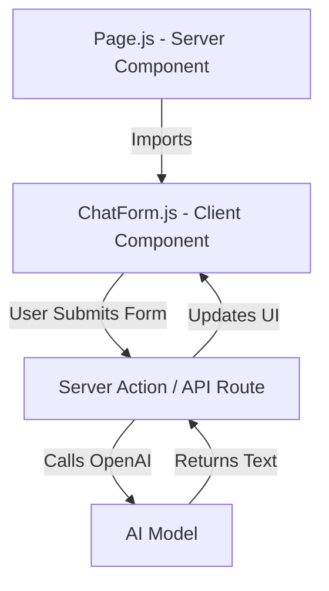
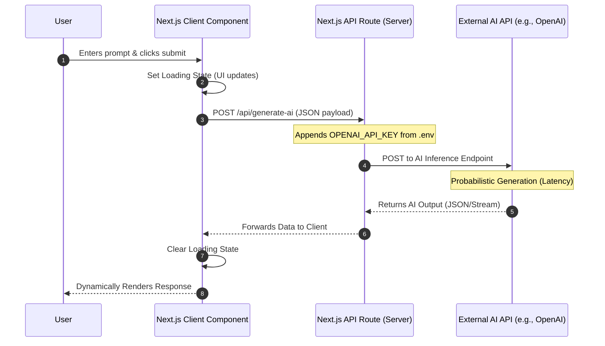

# ADVANCED FRONT-END DEVELOPMENT WITH NEXT.JS

**Session Time:** 120 minutes

---

## Table of Contents

1. Why Next.js for AI Applications?
2. Server vs. Client Components in AI Flows
3. Dynamic Data Fetching & Server Actions
4. Handling AI Latency: Streaming & Suspense
5. Lab: Building a Next.js AI Page
6. Wrap-Up and Reflection
7. Resources

---

## Module Overview

Learners use Next.js to create dynamic, high-performance front-end interfaces that interact with AI services through APIs. 

While the previous module focused on the backend "plumbing," this module focuses on the "glass"—the interface the user actually sees. 

We will explore how Next.js's architecture (specifically the App Router) simplifies connecting to AI models while managing the unique challenges of AI, such as long wait times (latency) and streaming text responses.

---

## Learning Objectives

By the end of this module, participants will be able to:

1. **Develop AI-responsive front-end components** using Next.js for dynamic rendering and data fetching.
2. **Differentiate** between Server Components (secure data fetching) and Client Components (interactive UI) in an AI context.
3. **Implement** user experience patterns that handle AI latency gracefully, such as Skeleton loaders and Streaming UI.
4. **Construct** a Next.js page that fetches and displays AI-generated text or images.


---

## Session Breakdown

| Segment | Topic | Duration (minutes) |
| --- | --- | --- |
| 1 | Why Next.js for AI Applications? | 20 |
| 2 | Server vs. Client Components in AI Flows | 25 |
| 3 | Dynamic Data Fetching & Server Actions | 25 |
| 4 | Handling AI Latency: Streaming & Suspense | 20 |
| 5 | Lab: Building a Next.js AI Page | 30 |

---

## 1. Why Next.js for AI Applications?

Before diving into AI integration, it's crucial to understand why we use **Next.js** instead of standard React for modern web applications. Next.js is a React framework that provides building blocks to create fast, full-stack web applications. 


For AI-powered apps, Next.js solves several major problems out-of-the-box:
* **Secure API Routes:** You can write backend code directly in your Next.js project. This is where we safely hide our `OPENAI_API_KEY`.
* **Server Components vs. Client Components:** Next.js allows you to render heavy components on the server (saving user bandwidth) and only use the client-side for interactive parts (like a chat input box).
* **Simplified Data Fetching:** Built-in caching and dynamic rendering make handling slow AI API responses much easier.

### Example: Server vs. Client in Next.js

In an AI app, you want the page shell to load instantly on the server, while the interactive AI chat box runs on the client.

**Server Component (Default in Next.js App Router):**
```jsx
// app/page.tsx
// This runs on the server. It is fast and secure.
import ChatInterface from './components/ChatInterface';

export default function AIPage() {
  return (
    <main className="p-4">
      <h1>AI Code Assistant</h1>
      <p>Ask our AI any coding question below.</p>
      {/* We import a Client Component for the interactive part */}
      <ChatInterface /> 
    </main>
  );
}

```

**Client Component:**

```jsx
// app/components/ChatInterface.tsx
'use client'; // This directive tells Next.js this runs in the browser

import { useState } from 'react';

export default function ChatInterface() {
  const [input, setInput] = useState('');
  
  // Interactive logic goes here...
  return (
    <input 
      value={input} 
      onChange={(e) => setInput(e.target.value)} 
      placeholder="Type your prompt..." 
    />
  );
}

```

---

## 2. Server vs. Client Components in AI Flows

The Next.js App Router distinguishes between components that run on the server and those that run in the browser.

||Server Components<br>(The Brain)|Client Components<br>(The Face)|
|---|---|---|
|**Role**|Fetch data, connect to databases, and hold API Keys.|Handle interactivity (clicks, typing, state).|
|**Usage in AI**|This is where you call your OpenAI/LLM helper function. It keeps your keys secure without needing a separate Express backend in some cases.|This is where you capture the user's prompt (form input) and display the "Typing..." animation.|

### Architecture Diagram



---
## 3. Core Architecture: Next.js and AI Integration

When integrating Next.js with an AI service like OpenAI, the architecture leverages Next.js as both the **Client** and the **Server** (Middleware).

### The Data Flow

1. **Client-Side Interaction:** The user interacts with a `'use client'` component (e.g., clicking "Generate").
2. **Next.js API Route (Backend):** The client sends a request to a Next.js Route Handler (e.g., `app/api/generate-ai/route.ts`).
3. **Secure AI Call:** The Route Handler injects the secure API key and forwards the prompt to the external AI Provider.
4. **Dynamic Rendering:** The AI Provider returns the data to the Route Handler, which passes it back to the Client Component to dynamically update the screen.

### Mermaid Diagram: Next.js AI Workflow



---

## 4. Dynamic Data Fetching & Server Actions

Next.js introduces **Server Actions**, which allow you to call a server-side function directly from a client-side button. This simplifies the "middleware" setup we did in previous modules.

### Server Action

Define a function explicitly marked with `'use server'` that runs on the server but can be imported into your Client Component.

### Example: A Server Action for AI

```javascript
// actions.js
'use server'

import OpenAI from 'openai';

export async function generateHaiku(topic) {
  const openai = new OpenAI({ apiKey: process.env.OPENAI_API_KEY });
  
  const completion = await openai.chat.completions.create({
    messages: [{ role: 'user', content: `Write a haiku about ${topic}` }],
    model: 'gpt-3.5-turbo',
  });

  return completion.choices[0].message.content;
}

```

---

## 5. Handling AI Latency: Streaming & Suspense

Since AI is slow, we cannot leave the user staring at a blank screen. Next.js leverages React **Suspense** to show fallback UI.

### User Experience Patterns

1. **Loading Spinners/Skeletons:** Immediate feedback that the request was sent.
2. **Streaming:** Displaying text chunk-by-chunk (like a typewriter) as it arrives, rather than waiting for the whole paragraph.

### Code Example: Handling Loading State

```javascript
// Client Component
'use client'
import { useState } from 'react';
import { generateHaiku } from './actions';

export default function HaikuGenerator() {
  const [haiku, setHaiku] = useState('');
  const [loading, setLoading] = useState(false);

  async function handleSubmit(formData) {
    setLoading(true);
    const result = await generateHaiku(formData.get('topic'));
    setHaiku(result);
    setLoading(false);
  }

  return (
    <form action={handleSubmit}>
      <input name="topic" placeholder="Enter topic..." />
      <button disabled={loading}>
        {loading ? 'Generating...' : 'Create Haiku'}
      </button>
      {haiku && <p className="result">{haiku}</p>}
    </form>
  );
}

```

---

## 6. Lab: Building a Next.js AI Page

Refer: [**Building a Next.js AI Page**](https://git.generalassemb.ly/build-ai-powered-web-apps/Lab3_Building-a-Next.js-AI-Page)


---

## 7. Wrap-Up and Reflection

**Reflection Questions:**

1. Why is it safe to use the OpenAI key in `actions.js` but not in `page.js` if it's a Client Component?
2. How does the User Experience (UX) of an AI app differ from a standard e-commerce site?

---

## 8. Resources

* [Next.js Documentation](https://nextjs.org/docs)
* [React Server Actions](https://react.dev/reference/react/use-server)
* [Vercel AI SDK (Advanced)](https://sdk.vercel.ai/docs)