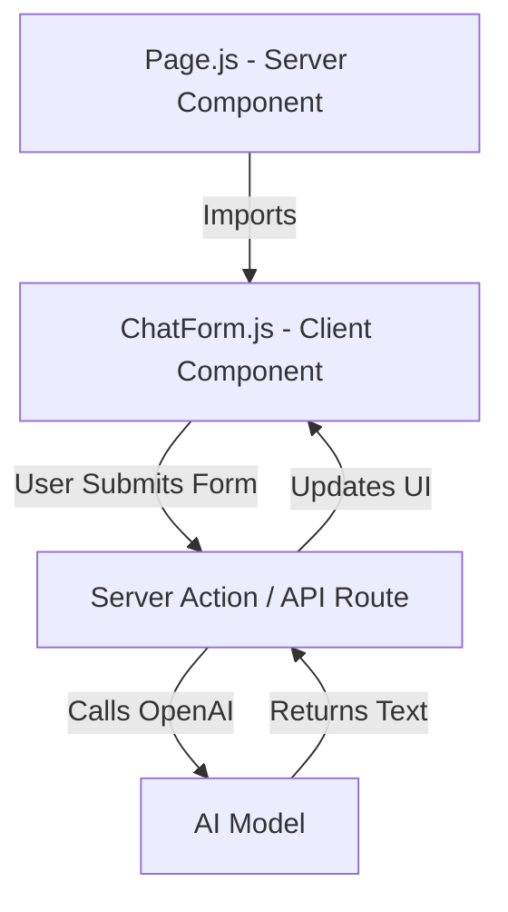

# Module: ADVANCED FRONT-END DEVELOPMENT WITH NEXT.JS

**Session Time:** 120 minutes

---

## Table of Contents

1. Why Next.js for AI Applications?
2. Server vs. Client Components in AI Flows
3. Dynamic Data Fetching & Server Actions
4. Handling AI Latency: Streaming & Suspense
5. Lab: Building a Next.js AI Page
6. Wrap-Up and Reflection
7. Resources

---

## Module Overview

Learners use Next.js to create dynamic, high-performance front-end interfaces that interact with AI services through APIs. While the previous module focused on the backend "plumbing," this module focuses on the "glass"—the interface the user actually sees. We will explore how Next.js's architecture (specifically the App Router) simplifies connecting to AI models while managing the unique challenges of AI, such as long wait times (latency) and streaming text responses.

---

## Learning Objectives

By the end of this module, participants will be able to:

1. **Develop AI-responsive front-end components** using Next.js for dynamic rendering and data fetching.
2. **Differentiate** between Server Components (secure data fetching) and Client Components (interactive UI) in an AI context.
3. **Implement** user experience patterns that handle AI latency gracefully, such as Skeleton loaders and Streaming UI.
4. **Construct** a Next.js page that fetches and displays AI-generated text or images.


---

## Session Breakdown

| Segment | Topic | Duration (minutes) |
| --- | --- | --- |
| 1 | Why Next.js for AI Applications? | 20 |
| 2 | Server vs. Client Components in AI Flows | 25 |
| 3 | Dynamic Data Fetching & Server Actions | 25 |
| 4 | Handling AI Latency: Streaming & Suspense | 20 |
| 5 | Lab: Building a Next.js AI Page | 30 |

---

## 1. Why Next.js for AI Applications?

In standard web development, data is usually instantaneous (database reads). In AI development, generating a response can take 2-10 seconds. Next.js provides a robust framework to handle this through **Server-Side Rendering (SSR)** and **Streaming**.

### Key Advantages:

* **Security:** You can keep API keys on the server side (Server Components) while still rendering UI.
* **Performance:** The server can start sending parts of the HTML to the user before the AI has finished "thinking" (Streaming).
* **SEO:** AI-generated content can be indexed by search engines if rendered on the server.

---

## 2. Server vs. Client Components in AI Flows

The Next.js App Router distinguishes between components that run on the server and those that run in the browser.

### Server Components (The Brain)

* **Role:** Fetch data, connect to databases, and hold API Keys.
* **Usage in AI:** This is where you call your OpenAI/LLM helper function. It keeps your keys secure without needing a separate Express backend in some cases.

### Client Components (The Face)

* **Role:** Handle interactivity (clicks, typing, state).
* **Usage in AI:** This is where you capture the user's prompt (form input) and display the "Typing..." animation.

### Architecture Diagram



---

## 3. Dynamic Data Fetching & Server Actions

Next.js introduces **Server Actions**, which allow you to call a server-side function directly from a client-side button. This simplifies the "middleware" setup we did in previous modules.

### Traditional API Route vs. Server Action

**Option A: The API Route (Traditional)**

1. Create `app/api/generate/route.js`.
2. Client fetches `/api/generate`.

**Option B: Server Actions (Modern Next.js)**
Define a function explicitly marked with `'use server'` that runs on the server but can be imported into your Client Component.

### Example: A Server Action for AI

```javascript
// actions.js
'use server'

import OpenAI from 'openai';

export async function generateHaiku(topic) {
  const openai = new OpenAI({ apiKey: process.env.OPENAI_API_KEY });
  
  const completion = await openai.chat.completions.create({
    messages: [{ role: 'user', content: `Write a haiku about ${topic}` }],
    model: 'gpt-3.5-turbo',
  });

  return completion.choices[0].message.content;
}

```

---

## 4. Handling AI Latency: Streaming & Suspense

Since AI is slow, we cannot leave the user staring at a blank screen. Next.js leverages React **Suspense** to show fallback UI.

### User Experience Patterns

1. **Loading Spinners/Skeletons:** Immediate feedback that the request was sent.
2. **Streaming:** Displaying text chunk-by-chunk (like a typewriter) as it arrives, rather than waiting for the whole paragraph.

### Code Example: Handling Loading State

```javascript
// Client Component
'use client'
import { useState } from 'react';
import { generateHaiku } from './actions';

export default function HaikuGenerator() {
  const [haiku, setHaiku] = useState('');
  const [loading, setLoading] = useState(false);

  async function handleSubmit(formData) {
    setLoading(true);
    const result = await generateHaiku(formData.get('topic'));
    setHaiku(result);
    setLoading(false);
  }

  return (
    <form action={handleSubmit}>
      <input name="topic" placeholder="Enter topic..." />
      <button disabled={loading}>
        {loading ? 'Generating...' : 'Create Haiku'}
      </button>
      {haiku && <p className="result">{haiku}</p>}
    </form>
  );
}

```

---

## 5. Lab: Building a Next.js AI Page

**Objective:** Build a Next.js page that fetches and displays AI-generated text or images.

### Step 1: Setup

1. Create a new Next.js app: `npx create-next-app@latest ai-front-end`.
2. Install the OpenAI SDK: `npm install openai`.
3. Create a `.env.local` file and add your `OPENAI_API_KEY`.

### Step 2: Create the Server Action

Create a file `app/actions.js`. Write a function that accepts a user prompt, calls OpenAI, and returns the text response.

### Step 3: Create the UI

In `app/page.js`:

1. Build a simple HTML form with a text input and a submit button.
2. Use the `'use client'` directive so you can manage `useState` for the input.
3. Import your server action.

### Step 4: Connect and Test

1. Bind the form's `action` to your server function.
2. Run the server: `npm run dev`.
3. Type a prompt (e.g., "Explain Quantum Physics to a 5-year-old") and verify the AI text appears on the screen.

### Step 5: Add Polish (Challenge)

Add a "Loading..." state that disables the button while the AI is thinking.

---

## 6. Wrap-Up and Reflection

**Reflection Questions:**

1. Why is it safe to use the OpenAI key in `actions.js` but not in `page.js` if it's a Client Component?
2. How does the User Experience (UX) of an AI app differ from a standard e-commerce site?

---

## 7. Resources

* [Next.js Documentation](https://nextjs.org/docs)
* [React Server Actions](https://react.dev/reference/react/use-server)
* [Vercel AI SDK (Advanced)](https://sdk.vercel.ai/docs)